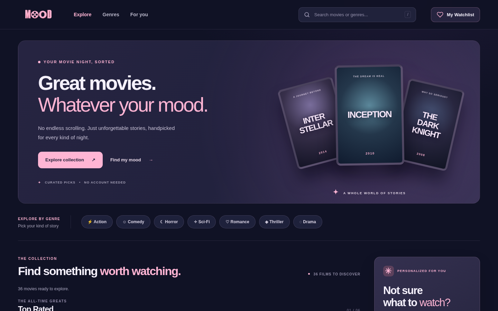
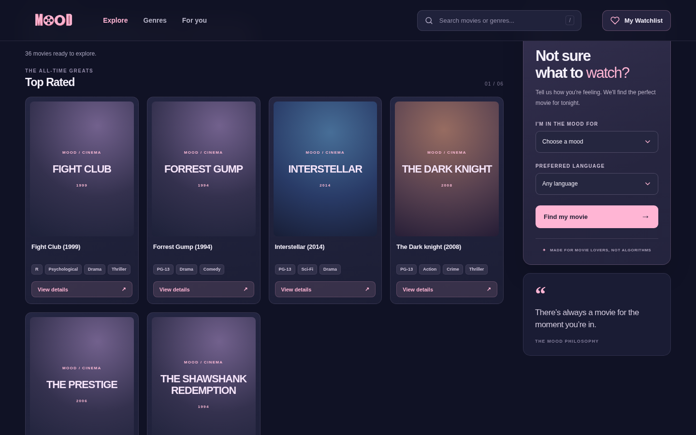
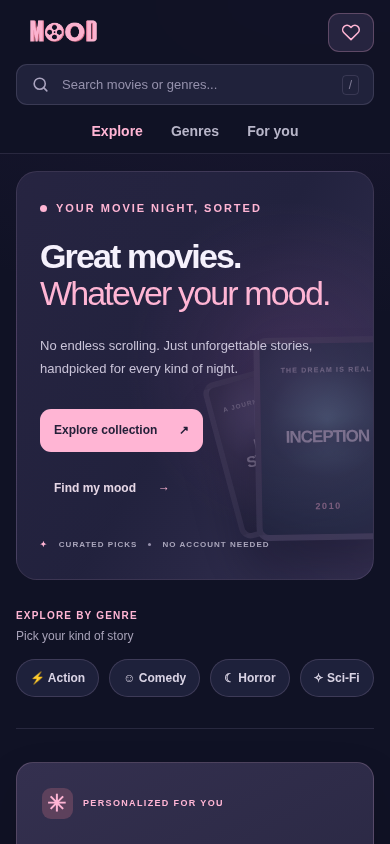

# MOOD — Movie Recommendation System

A working **Python + FastAPI college project** based on Sanyam's supplied HTML/CSS/JavaScript frontend. The original MOOD branding and logo are preserved in a redesigned **desktop-first, responsive web interface**. Search, genre links, recommendations, movie details and guest wishlists are powered by a real API.

> **Scope:** a *content-based, rule-driven* recommender. No machine-learning model is claimed. No movie API key, paid service or PostgreSQL setup is required.

## Quick start (Ubuntu/Linux/macOS)

Requires **Python 3.10+**. In a terminal:

```bash
cd MOOD_Python_FastAPI
python3 -m venv .venv
source .venv/bin/activate
python -m pip install -r requirements.txt
uvicorn app.main:app --reload
```

Open **http://127.0.0.1:8000/**. FastAPI API documentation: **http://127.0.0.1:8000/docs**.

On Windows PowerShell, activate the environment with `.venv\Scripts\Activate.ps1` instead. Run all commands from the project root (the folder containing `requirements.txt`).

A local `mood.db` SQLite database is automatically created and filled from `data/movies.csv` the first time you start the server. No manual database creation is necessary. **Do not open `index.html` directly as a file**: launch the server and visit localhost so frontend API requests work.

## Features

- 36 movies imported from the supplied frontend design into a CSV-backed relational catalog
- Browse six curated homepage sections in a responsive desktop movie grid
- Search movie titles and genres from the desktop header (press `/` to focus search)
- Filter by the seven genre tabs
- Recommendation form matching *mood and language*, with transparent scoring/filtering
- Dedicated details page with synopsis, genres, language, and known IMDb rating/director where available
- Save, list and remove wishlist movies, persisted in SQLite for the browser's guest UUID
- Interactive OpenAPI docs and automated API tests
- Featured movie hero, genre filter pills, responsive recommendation sidebar and visually consistent details/watchlist pages
- Designed for widescreen laptops (1024–1440px) while staying usable on narrow mobile screens
- Fallback poster artwork when external image sources are unavailable

## How the recommendation algorithm works

1. User selects one of six moods and a language (`Any` is also supported).
2. Candidate movies are filtered by language *first*. If no movie matches a language, the result is empty rather than returning a movie in the wrong language.
3. For action/thrill, romance, horror and sci-fi moods, the app checks each movie's genre tags. For action/thrill, titles matching **both** Action and Thriller score above titles matching only one. Sci-fi thrillers receive a small additional score.
4. **A classic** selects movies released in or before 2000; **Hidden gems** selects the hand-curated `Underrated` section.
5. Movies are deterministically sorted and limited to the requested number.

This is an explainable, rule-based content recommender. It does **not** use personal behavioral data, machine learning, embeddings or collaborative filtering. Genre/language tags were curated from the supplied prototype and lightweight annotations; the dataset is for demo purposes rather than authoritative film metadata. Only *Inception* carries an IMDb rating and director in this sample. Poster images use the external URLs found in the original frontend; image loading therefore requires internet access, and a placeholder is shown when an image fails.

## Project structure

```text
MOOD_Python_FastAPI/
├── app/
│   ├── main.py            # App, API endpoints, static frontend hosting
│   ├── database.py        # SQLAlchemy engine / session configuration
│   ├── models.py          # movies and wishlist_items tables
│   ├── schemas.py         # Pydantic request/response validation
│   ├── recommender.py     # Content-based movie ranking logic
│   └── seed.py            # Load initial movie CSV
├── data/movies.csv        # Editable movie catalog, 36 titles
├── frontend/
│   ├── index.html         # Desktop-first responsive homepage
│   ├── movie.html         # Dynamic movie details
│   ├── wishlist.html      # Saved movies
│   ├── script.js          # Calls FastAPI from the browser
│   ├── style.css          # Desktop responsive layout / MOOD theme
│   └── *.png              # Original frontend image assets
├── tests/test_app.py      # API integration tests
├── requirements.txt
├── requirements-dev.txt
└── README.md
```

## API reference

| Method | Endpoint | Purpose |
|:--|:--|:--|
| GET | `/api/v1/health` | Check backend |
| GET | `/api/v1/movies` | List/search/filter movies (`search`, `genre`, `language`, `section`, `limit`) |
| GET | `/api/v1/movies/{movie_id}` | Single movie details |
| GET | `/api/v1/genres` | Available genres |
| GET | `/api/v1/languages` | Available languages |
| POST | `/api/v1/recommendations` | Mood/language recommendations |
| GET | `/api/v1/wishlist` | Guest's saved movies |
| POST | `/api/v1/wishlist/{movie_id}` | Save a movie |
| DELETE | `/api/v1/wishlist/{movie_id}` | Remove a saved movie |

### Example: recommendation request

From a second terminal while the server is running:

```bash
curl -X POST http://127.0.0.1:8000/api/v1/recommendations \
  -H 'Content-Type: application/json' \
  -d '{"mood":"Something scary","language":"Japanese","limit":6}'
```

The sample should return the Japanese horror film **Ringu**.

```bash
curl 'http://127.0.0.1:8000/api/v1/movies?search=inception'
curl 'http://127.0.0.1:8000/api/v1/movies?genre=Action'
```

### Guest wishlist

The browser automatically creates a UUID in local storage and sends it as `X-Guest-ID` with wishlist requests. For a manual API test, use any valid UUID:

```bash
curl -X POST http://127.0.0.1:8000/api/v1/wishlist/inception-2010 \
  -H 'X-Guest-ID: 123e4567-e89b-12d3-a456-426614174000'
```

**Note:** this guest identifier is a convenience for a local class demo, **not secure authentication**. Do not use it to protect real users' private data in production.

## Test

```bash
python -m pip install -r requirements-dev.txt
python -m pytest -q
```

There are ten automated tests covering catalog seeding, search, filters, moods, language matching, data validation, wishlist persistence/isolation, frontend hosting and error cases. Tests use their own temporary SQLite databases, leaving your regular `mood.db` unchanged.

## Database design

`movies`: `id` (slug PK), `title`, `year`, `content_rating`, `genres` (JSON list), `language`, `section`, `poster_url`, `overview`, `director` (optional), `imdb_rating` (optional).

`wishlist_items`: compound primary key (`guest_id`, `movie_id`), with `movie_id` referencing `movies.id`. A movie can appear in many guest wishlists, but only once per guest.

The redesigned frontend is plain HTML/CSS/vanilla JS and needs **no Node, npm, React, or separate web server**. Start Uvicorn, and FastAPI serves the site and API at the same address.

The project uses SQLAlchemy ORM and Pydantic schemas; SQLite is used so it runs immediately on a college laptop. To reset the catalog after editing `data/movies.csv`, stop the server, delete the local `mood.db` file, then start the server again (this also resets saved wishlists). The `MOOD_DATABASE_URL` environment variable can point to a different SQLAlchemy-compatible database if the corresponding driver is installed.

## Viva: quick answers

**Q: Why FastAPI?** Python framework for request validation, type-driven APIs and automatic Swagger documentation.

**Q: Where is the recommendation logic?** `app/recommender.py`. It filters by user preferences and ranks films using their genres and catalog labels.

**Q: Is this machine learning?** No. It is a content-based rule-driven recommendation prototype, and we clearly label it as such.

**Q: How is data saved?** SQLAlchemy persists movie records and wishlist entries in SQLite. Initial records are loaded from `data/movies.csv`.

**Q: How does the frontend talk to Python?** JavaScript `fetch()` sends HTTP requests to `/api/v1/...` routes on the same FastAPI server. FastAPI also serves the frontend itself.

**Q: Why no PostgreSQL?** SQLite requires no separate database installation for this class project; the SQLAlchemy model layer can later be adapted to PostgreSQL.

## Team contributions

- **Frontend foundation:** Sanyam (supplied original layout, visual styling, logo and static movie cards).
- **Python API, recommendation logic, database, integration and testing:** backend implementation prepared for the college submission.

Update credits according to your actual team requirements before submitting. This project is a **demonstration**, not a licensed movie streaming or downloading service; **Get** opens movie details, not a film download.

## Desktop previews

The previews below were rendered in Chromium using a simulated API and local fallback artwork (the original remote movie artwork will display when available online):







## Desktop layout update (October 2026)

This release turns the earlier mobile-style horizontal shelves into a desktop web layout:

- Sticky header with MOOD logo, navigation, search and watchlist
- Desktop hero and genre quick filters
- Responsive three/four-column movie grids; two columns on phones
- Sticky mood recommendation panel next to movie shelves on desktop; stacked on mobile
- Unified movie-details and watchlist pages
- No horizontal page overflow at tested viewports of 1440px, 1024px and 390px

**Compatibility testing:** API tests pass with `python -m pytest -q`. Browser interactions and layout were checked with Chromium using a simulated API because the sandbox blocks live local-browser connections. The API itself was exercised separately using FastAPI's TestClient. Check the site in your own browser at `http://127.0.0.1:8000` before publishing. External movie posters load only when their third-party hosts are reachable.

### Upload to GitHub

Once you've run it locally and verified the appearance, from the project directory:

```bash
git status
git add .
git commit -m "feat: build desktop-first MOOD movie recommendation UI"
git push origin main
```

These commands assume the folder is already a Git repository on the `main` branch with an `origin` remote. Otherwise initialize a new Git repository or add a remote first. The database file `mood.db` and virtual environment are excluded by `.gitignore`.
